# FleetSync — Class diagram

Text version of the team's UML class diagram (27 Oct 2026), derived from the EER in [data-model.md](data-model.md):
32 classes, 6 generalizations, 33 associations, 5 aggregations and 9 compositions.
Image export: [diagrams/class-diagram.png](diagrams/class-diagram.png).

This file records the diagram **as drawn**. Known problems are tracked in [design-issues.md](design-issues.md).

## How it maps from the EER

- `User` is abstract because the EER specialization is total; the six roles inherit its protected (`#`) attributes.
- The weak entities CHAT_PARTICIPANT and MAIL_RECIPIENT become compositions owned by `ChatConversation` and `MailMessage`.
- The composite pickup and destination attributes become a composed `Location` class (two per order).
- The derived driver status is `/availabilityStatus`; the multivalued `parts_used` is `List<String>`.
- Status and role types (`TripStatus`, `OrderStatus` and so on) are enumerations. Their values are not defined in the
  diagram; see "Status and type values" in [data-model.md](data-model.md) and DI-14.

Notation: `+` public, `-` private, `#` protected, `~` package. Filled diamond (`*--`) = composition, the part is deleted
with the whole; hollow diamond (`o--`) = aggregation, the part can exist alone; numbers are multiplicities.
In Mermaid, `List~String~` means `List<String>`.

## How to use it in the backend

The diagram describes the domain, not the code layout. In the ASP.NET Core solution:

- Attributes become properties of Domain entities. Behaviour that changes only the entity's own state
  (`Trip.start()`, `Trip.complete(endOdometer)`, `FareQuotation.accept()`, `ServiceSchedule.isDue(...)`) belongs on the entity,
  where it can enforce the state rules.
- Methods drawn on the role classes (`OperationalCoordinator.createTrip(...)`, `Customer.makePayment(...)`) are use cases.
  Implement them as Application-layer services or command handlers that check the caller's role, not as methods on a user object.
- Methods that talk to outside systems (`Payment.verifyWithGateway()`, `Notification.send()`, `Invoice.generatePdf()`,
  `Document.download()`) go behind interfaces in Application, implemented in Infrastructure.
- Password handling (`passwordHash`, `login`, `hashPassword`) is done by ASP.NET Core Identity, per the
  Authentication API Contract (DI-03).

## Diagram (Mermaid)

```mermaid
classDiagram
    class User {
        <<abstract>>
        #userId: int
        #fullName: String
        #email: String
        #phone: String
        -passwordHash: String
        #isActive: boolean
        #createdAt: DateTime
        #updatedAt: DateTime
        +login(email: String, password: String) boolean
        +logout() void
        +updateProfile(fullName: String, phone: String) void
        +changePassword(oldPassword: String, newPassword: String) boolean
        ~hashPassword(raw: String) String
    }
    class FleetAdministrator {
        +reviewApplication(application: UserApplication, approve: boolean) void
        +registerCompany(company: CustomerCompany) void
        +approveProfileChange(request: ProfileChangeRequest) void
        +deactivateUser(userId: int) void
    }
    class Customer {
        +placeOrder(order: TransportOrder) TransportOrder
        +acceptQuotation(quotation: FareQuotation) void
        +makePayment(orderId: int, amount: double) Payment
        +trackTrip(tripId: int) Trip
    }
    class OperationalCoordinator {
        +reviewOrder(order: TransportOrder, accept: boolean) void
        +prepareQuotation(order: TransportOrder, amount: double) FareQuotation
        +createTrip(order: TransportOrder) Trip
        +assignResources(trip: Trip, driver: Driver, vehicle: Vehicle) void
        +generateReport(reportType: String) ReportExport
    }
    class Driver {
        -licenceNumber: String
        -licenceExpiry: Date
        -/availabilityStatus: String
        +updateTripStatus(trip: Trip, status: TripStatus) void
        +addTripNote(trip: Trip, text: String) TripNote
        +reportIssue(vehicle: Vehicle, description: String) VehicleIssue
        +isAvailable() boolean
    }
    class Mechanic {
        +recordMaintenance(vehicle: Vehicle, log: MaintenanceLog) void
        +resolveIssue(issue: VehicleIssue) void
        +supportTrip(trip: Trip) void
    }
    class FleetOwner {
        +viewDashboard() void
        +exportReport(reportType: String, filters: String) ReportExport
    }
    class UserApplication {
        -applicationId: int
        -applicantName: String
        -applicantEmail: String
        -applicantPhone: String
        -requestedRole: UserRole
        -licenceNumber: String
        -licenceExpiry: Date
        -applicationStatus: ApplicationStatus
        -submittedAt: DateTime
        -reviewedAt: DateTime
        -rejectionReason: String
        +submit() void
        +approve() User
        +reject(reason: String) void
    }
    class ProfileChangeRequest {
        -requestId: int
        -fieldName: String
        -oldValue: String
        -newValue: String
        -requestStatus: RequestStatus
        -requestedAt: DateTime
        -reviewedAt: DateTime
        +approve() void
        +reject() void
    }
    class CustomerCompany {
        -companyId: int
        -companyName: String
        -contactPerson: String
        -telephone: String
        -email: String
        -address: String
        +addCustomer(customer: Customer) void
        +getOrders() List~TransportOrder~
    }
    class TransportOrder {
        -orderId: int
        -cargoDetails: String
        -requiredDate: Date
        -orderStatus: OrderStatus
        -notes: String
        -createdAt: DateTime
        +submit() void
        +cancel(reason: String) void
        +updateStatus(status: OrderStatus) void
        +getTotalPaid() double
    }
    class Location {
        -address: String
        -city: String
        +format() String
    }
    class FareQuotation {
        -quotationId: int
        -estimatedAmount: double
        -currency: String
        -quotationStatus: QuotationStatus
        -createdAt: DateTime
        -respondedAt: DateTime
        +accept() void
        +reject() void
    }
    class Trip {
        -tripId: int
        -tripStatus: TripStatus
        -startDate: DateTime
        -actualReturnDate: DateTime
        -startOdometer: int
        -endOdometer: int
        -cancellationReason: String
        +start() void
        +complete(endOdometer: int) void
        +cancel(reason: String) void
        ~distanceTravelled() int
    }
    class Vehicle {
        -vehicleId: int
        -registrationNumber: String
        -model: String
        -manufactureYear: int
        -capacity: double
        -currentOdometer: int
        -status: VehicleStatus
        +updateOdometer(reading: int) void
        +isAvailable() boolean
        +getNextService() ServiceSchedule
    }
    class MaintenanceLog {
        -maintenanceId: int
        -serviceDate: Date
        -description: String
        -partsUsed: List~String~
        -cost: double
        -odometer: int
        +addPart(part: String) void
        +attachDocument(document: Document) void
    }
    class ServiceType {
        -serviceTypeId: int
        -name: String
        -description: String
        +getSchedules() List~ServiceSchedule~
    }
    class ServiceSchedule {
        -scheduleId: int
        -dueDate: Date
        -dueOdometer: int
        -scheduleStatus: ScheduleStatus
        -completedAt: DateTime
        +isDue(currentOdometer: int) boolean
        +markCompleted() void
    }
    class VehicleIssue {
        -issueId: int
        -issueDescription: String
        -severity: Severity
        -issueStatus: IssueStatus
        -reportedAt: DateTime
        -resolvedAt: DateTime
        +resolve() void
        +escalate() void
    }
    class TripNote {
        -noteId: int
        -noteText: String
        -createdAt: DateTime
        +edit(text: String) void
    }
    class Payment {
        -paymentId: int
        -amount: double
        -currency: String
        -paymentMethod: String
        -gatewayReference: String
        -paymentStatus: PaymentStatus
        -paidAt: DateTime
        +process() boolean
        +verifyWithGateway() boolean
        +refund() Refund
        -buildGatewayRequest() String
    }
    class Refund {
        -refundId: int
        -amount: double
        -currency: String
        -refundStatus: RefundStatus
        -gatewayRefundReference: String
        -initiatedAt: DateTime
        -completedAt: DateTime
        -failureReason: String
        +initiate() void
        +markCompleted(reference: String) void
        +markFailed(reason: String) void
    }
    class Invoice {
        -invoiceId: int
        -invoiceNumber: String
        -totalAmount: double
        -issuedAt: DateTime
        -fileReference: String
        +generatePdf() String
        +send(email: String) void
    }
    class Document {
        -documentId: int
        -fileName: String
        -fileType: String
        -storagePath: String
        -uploadedAt: DateTime
        +download() byte[]
        +delete() void
    }
    class ChatConversation {
        -conversationId: int
        -conversationType: ConversationType
        -createdAt: DateTime
        +addParticipant(user: User) void
        +sendMessage(sender: User, text: String) ChatMessage
        +getMessages() List~ChatMessage~
    }
    class ChatParticipant {
        -joinedAt: DateTime
        +leave() void
    }
    class ChatMessage {
        -messageId: int
        -messageText: String
        -sentAt: DateTime
        +edit(text: String) void
    }
    class MailMessage {
        -mailId: int
        -subject: String
        -body: String
        -sentAt: DateTime
        +send() void
        +addRecipient(user: User, type: RecipientType) void
        +attach(document: Document) void
    }
    class MailRecipient {
        -recipientType: RecipientType
        -readAt: DateTime
        +markAsRead() void
    }
    class Notification {
        -notificationId: int
        -recipientEmail: String
        -channel: Channel
        -notificationType: String
        -subject: String
        -deliveryStatus: DeliveryStatus
        -createdAt: DateTime
        -sentAt: DateTime
        +send() boolean
        +retry() void
    }
    class ReportExport {
        -reportId: int
        -reportType: String
        -filterParameters: String
        -fileReference: String
        -generatedAt: DateTime
        +generate() void
        +download() byte[]
    }
    class AuditLog {
        -auditId: int
        -entityType: String
        -entityId: int
        -action: String
        -occurredAt: DateTime
        -details: String
        ~record(action: String, details: String) void
    }

    User <|-- FleetAdministrator
    User <|-- Customer
    User <|-- OperationalCoordinator
    User <|-- Driver
    User <|-- Mechanic
    User <|-- FleetOwner
    MailMessage "1" *-- "1..*" MailRecipient : addressed to
    User "1" -- "0..*" MailRecipient : receives
    ChatConversation "1" *-- "1..*" ChatParticipant : members
    MailMessage "0..1" o-- "0..*" Document : attaches
    TransportOrder "1" *-- "2" Location : pickup / destination
    Payment "1" *-- "0..1" Refund : refunded by
    User "1" -- "0..*" ChatParticipant : joins as
    FleetAdministrator "0..1" -- "0..*" UserApplication : reviews
    FleetAdministrator "1" -- "0..*" CustomerCompany : registers
    ServiceType "1" -- "0..*" MaintenanceLog : categorizes
    TransportOrder "1" *-- "0..*" FareQuotation : has
    Vehicle "1" o-- "0..*" VehicleIssue : has
    ServiceType "1" -- "0..*" ServiceSchedule : defines
    FleetOwner "0..1" -- "0..*" ReportExport : exports
    ChatConversation "1" *-- "0..*" ChatMessage : contains
    Customer "1" -- "0..*" TransportOrder : places
    Mechanic "1" -- "0..*" MaintenanceLog : records
    OperationalCoordinator "1" -- "0..*" Trip : creates
    Driver "0..1" -- "0..*" Trip : drives
    OperationalCoordinator "1" -- "0..*" FareQuotation : prepares
    User "1" -- "0..*" ChatConversation : starts
    User "1" -- "0..*" MailMessage : sends
    Trip "1" *-- "0..*" TripNote : has
    Trip "1" -- "0..1" Refund : triggers
    FleetAdministrator "0..1" -- "0..*" ProfileChangeRequest : approves
    Vehicle "1" o-- "0..*" MaintenanceLog : has
    TransportOrder "1" -- "0..*" Payment : paid by
    TransportOrder "1" *-- "0..1" Invoice : billed by
    Vehicle "0..1" -- "0..*" Trip : assigned to
    Driver "1" -- "0..*" TripNote : writes
    OperationalCoordinator "0..1" -- "0..*" TransportOrder : reviews
    Driver "1" -- "0..*" VehicleIssue : reports
    VehicleIssue "0..1" -- "0..*" MaintenanceLog : addressed by
    Trip "0..1" -- "0..*" VehicleIssue : occurs during
    CustomerCompany "0..1" o-- "0..*" Customer : belongs to
    MaintenanceLog "0..1" o-- "0..*" Document : attachments
    User "1" -- "0..*" Document : uploads
    ChatConversation "0..*" -- "0..1" TransportOrder : about
    User "1" -- "0..*" ChatMessage : sends
    TransportOrder "1" -- "0..1" Trip : produces
    Vehicle "1" *-- "0..*" ServiceSchedule : has
    Mechanic "0..1" -- "0..*" Trip : supports
    User "0..1" -- "0..*" Notification : receives
    User "1" -- "0..*" ProfileChangeRequest : requests
    User "1" -- "0..*" AuditLog : performs
    UserApplication "0..1" -- "0..1" User : results in
    OperationalCoordinator "0..1" -- "0..*" ReportExport : generates
```

## Relationship list

| From | Mult. | Kind | Mult. | To | Label |
|---|---|---|---|---|---|
| MailMessage | 1 | composition | 1..* | MailRecipient | addressed to |
| User | 1 | association | 0..* | MailRecipient | receives |
| ChatConversation | 1 | composition | 1..* | ChatParticipant | members |
| MailMessage | 0..1 | aggregation | 0..* | Document | attaches |
| TransportOrder | 1 | composition | 2 | Location | pickup / destination |
| Payment | 1 | composition | 0..1 | Refund | refunded by |
| User | 1 | association | 0..* | ChatParticipant | joins as |
| FleetAdministrator | 0..1 | association | 0..* | UserApplication | reviews |
| FleetAdministrator | 1 | association | 0..* | CustomerCompany | registers |
| ServiceType | 1 | association | 0..* | MaintenanceLog | categorizes |
| TransportOrder | 1 | composition | 0..* | FareQuotation | has |
| Vehicle | 1 | aggregation | 0..* | VehicleIssue | has |
| ServiceType | 1 | association | 0..* | ServiceSchedule | defines |
| FleetOwner | 0..1 | association | 0..* | ReportExport | exports |
| ChatConversation | 1 | composition | 0..* | ChatMessage | contains |
| Customer | 1 | association | 0..* | TransportOrder | places |
| Mechanic | 1 | association | 0..* | MaintenanceLog | records |
| OperationalCoordinator | 1 | association | 0..* | Trip | creates |
| Driver | 0..1 | association | 0..* | Trip | drives |
| OperationalCoordinator | 1 | association | 0..* | FareQuotation | prepares |
| User | 1 | association | 0..* | ChatConversation | starts |
| User | 1 | association | 0..* | MailMessage | sends |
| Trip | 1 | composition | 0..* | TripNote | has |
| Trip | 1 | association | 0..1 | Refund | triggers |
| FleetAdministrator | 0..1 | association | 0..* | ProfileChangeRequest | approves |
| Vehicle | 1 | aggregation | 0..* | MaintenanceLog | has |
| TransportOrder | 1 | association | 0..* | Payment | paid by |
| TransportOrder | 1 | composition | 0..1 | Invoice | billed by |
| Vehicle | 0..1 | association | 0..* | Trip | assigned to |
| Driver | 1 | association | 0..* | TripNote | writes |
| OperationalCoordinator | 0..1 | association | 0..* | TransportOrder | reviews |
| Driver | 1 | association | 0..* | VehicleIssue | reports |
| VehicleIssue | 0..1 | association | 0..* | MaintenanceLog | addressed by |
| Trip | 0..1 | association | 0..* | VehicleIssue | occurs during |
| CustomerCompany | 0..1 | aggregation | 0..* | Customer | belongs to |
| MaintenanceLog | 0..1 | aggregation | 0..* | Document | attachments |
| User | 1 | association | 0..* | Document | uploads |
| ChatConversation | 0..* | association | 0..1 | TransportOrder | about |
| User | 1 | association | 0..* | ChatMessage | sends |
| TransportOrder | 1 | association | 0..1 | Trip | produces |
| Vehicle | 1 | composition | 0..* | ServiceSchedule | has |
| Mechanic | 0..1 | association | 0..* | Trip | supports |
| User | 0..1 | association | 0..* | Notification | receives |
| User | 1 | association | 0..* | ProfileChangeRequest | requests |
| User | 1 | association | 0..* | AuditLog | performs |
| UserApplication | 0..1 | association | 0..1 | User | results in |
| OperationalCoordinator | 0..1 | association | 0..* | ReportExport | generates |
| FleetAdministrator | | generalization | | User | is a |
| Customer | | generalization | | User | is a |
| OperationalCoordinator | | generalization | | User | is a |
| Driver | | generalization | | User | is a |
| Mechanic | | generalization | | User | is a |
| FleetOwner | | generalization | | User | is a |
