# FleetSync — Data model (EER)

Text version of the team's Enhanced ER diagram, **version 2 (27 Oct 2026)**, Chen notation:
31 entities, 46 relationships. Image export: [diagrams/eer-diagram.png](diagrams/eer-diagram.png).

Version 2 replaced the first version drawn on the FigJam board
([board](https://www.figma.com/board/ORNztIyq70OekO56A7vBk2), section "EER"). The board copy is out of date: it has
no REFUND entity and uses the old cardinalities. Changes in version 2:

- New **REFUND** entity, linked by *Refunded by* to PAYMENT and *Triggers* from TRIP.
- *Drives*, *Assigned to*, *Supports*: the driver, vehicle and mechanic side is now 0..1, so a trip can exist as a draft before resources are assigned.
- *Reviews*, *Approves change*, *Reviews order*: the reviewer side is now 0..1 while the item is still pending.
- *Belongs to*: the customer side changed from N to 0..N.
- The duplicate *Exports* became *Generates* (coordinator) and *Exports* (owner), each 0..1.
- Composite city parts renamed `pickup_city` and `destination_city` so attribute names stay unique.

This file records the diagram **as drawn**. Known problems — gaps against the Requirements Analysis &
Refinement Document, the Authentication API Contract, the Figma screens and the code — are tracked in
[design-issues.md](design-issues.md). When code has to differ from this model, follow the rule in
`apps/api/CLAUDE.md`: name the issue, then update this file in the same pull request.

## Notation used below

| Mark | Meaning |
|---|---|
| **PK** | Key attribute (underlined in the diagram) |
| *derived* | Derived attribute (dashed ellipse): calculated, not stored |
| *multivalued* | Multivalued attribute (double ellipse) |
| *composite* | Composite attribute: its parts are listed |
| weak | Weak entity (double rectangle), identified through its owners |
| 0..1, 1, 0..N, 1..N | How many of the entity on that side relate to **one** instance on the other side |

## Specialization

`USER` is specialized into six role entities: **total and disjoint** (`d`, double line from USER).
Every user is exactly one of: FLEET_ADMINISTRATOR, CUSTOMER, OPERATIONAL_COORDINATOR, DRIVER, MECHANIC, FLEET_OWNER.
Roles are modelled by this specialization only; there are no ROLE or PERMISSION entities.
Only DRIVER has attributes of its own.

## Diagram (Mermaid)

GitHub renders this block. Mermaid cannot draw the specialization, so it is shown as `is a` links.

```mermaid
erDiagram
    USER {
        int user_id PK
        string full_name
        string email
        string phone
        string password_hash
        boolean is_active
        datetime created_at
        datetime updated_at
    }
    DRIVER {
        string licence_number
        date licence_expiry
        string availability_status "derived"
    }
    USER_APPLICATION {
        int application_id PK
        string applicant_name
        string applicant_email
        string applicant_phone
        string requested_role
        string licence_number
        date licence_expiry
        string application_status
        datetime submitted_at
        datetime reviewed_at
        string rejection_reason
    }
    PROFILE_CHANGE_REQUEST {
        int request_id PK
        string field_name
        string old_value
        string new_value
        string request_status
        datetime requested_at
        datetime reviewed_at
    }
    CUSTOMER_COMPANY {
        int company_id PK
        string company_name
        string contact_person
        string telephone
        string email
        string address
    }
    TRANSPORT_ORDER {
        int order_id PK
        string pickup_address "composite pickup_location"
        string pickup_city "composite pickup_location"
        string destination_address "composite destination"
        string destination_city "composite destination"
        string cargo_details
        date required_date
        string order_status
        string notes
        datetime created_at
    }
    FARE_QUOTATION {
        int quotation_id PK
        double estimated_amount
        string currency
        string quotation_status
        datetime created_at
        datetime responded_at
    }
    TRIP {
        int trip_id PK
        string trip_status
        datetime start_date
        datetime actual_return_date
        int start_odometer
        int end_odometer
        string cancellation_reason
    }
    VEHICLE {
        int vehicle_id PK
        string registration_number
        string model
        int manufacture_year
        double capacity
        int current_odometer
        string status
    }
    MAINTENANCE_LOG {
        int maintenance_id PK
        date service_date
        string description
        string parts_used "multivalued"
        double cost
        int odometer
    }
    SERVICE_TYPE {
        int service_type_id PK
        string name
        string description
    }
    SERVICE_SCHEDULE {
        int schedule_id PK
        date due_date
        int due_odometer
        string schedule_status
        datetime completed_at
    }
    VEHICLE_ISSUE {
        int issue_id PK
        string issue_description
        string severity
        string issue_status
        datetime reported_at
        datetime resolved_at
    }
    TRIP_NOTE {
        int note_id PK
        string note_text
        datetime created_at
    }
    PAYMENT {
        int payment_id PK
        double amount
        string currency
        string payment_method
        string gateway_reference
        string payment_status
        datetime paid_at
    }
    REFUND {
        int refund_id PK
        double amount
        string currency
        string refund_status
        string gateway_refund_reference
        datetime initiated_at
        datetime completed_at
        string failure_reason
    }
    INVOICE {
        int invoice_id PK
        string invoice_number
        double total_amount
        datetime issued_at
        string file_reference
    }
    DOCUMENT {
        int document_id PK
        string file_name
        string file_type
        string storage_path
        datetime uploaded_at
    }
    CHAT_CONVERSATION {
        int conversation_id PK
        string conversation_type
        datetime created_at
    }
    CHAT_PARTICIPANT {
        datetime joined_at "weak entity"
    }
    CHAT_MESSAGE {
        int message_id PK
        string message_text
        datetime sent_at
    }
    MAIL_MESSAGE {
        int mail_id PK
        string subject
        string body
        datetime sent_at
    }
    MAIL_RECIPIENT {
        string recipient_type "weak entity"
        datetime read_at
    }
    NOTIFICATION {
        int notification_id PK
        string recipient_email
        string channel
        string notification_type
        string subject
        string delivery_status
        datetime created_at
        datetime sent_at
    }
    REPORT_EXPORT {
        int report_id PK
        string report_type
        string filter_parameters
        string file_reference
        datetime generated_at
    }
    AUDIT_LOG {
        int audit_id PK
        string entity_type
        int entity_id
        string action
        datetime occurred_at
        string details
    }

    USER ||--o| FLEET_ADMINISTRATOR : "is a"
    USER ||--o| CUSTOMER : "is a"
    USER ||--o| OPERATIONAL_COORDINATOR : "is a"
    USER ||--o| DRIVER : "is a"
    USER ||--o| MECHANIC : "is a"
    USER ||--o| FLEET_OWNER : "is a"

    FLEET_ADMINISTRATOR |o--o{ USER_APPLICATION : "Reviews"
    FLEET_ADMINISTRATOR ||--o{ CUSTOMER_COMPANY : "Registers"
    FLEET_ADMINISTRATOR |o--o{ PROFILE_CHANGE_REQUEST : "Approves change"
    USER ||--o{ PROFILE_CHANGE_REQUEST : "Requests change"
    USER_APPLICATION |o--o| USER : "Results in"
    CUSTOMER_COMPANY |o--o{ CUSTOMER : "Belongs to"
    CUSTOMER ||--o{ TRANSPORT_ORDER : "Places"
    OPERATIONAL_COORDINATOR |o--o{ TRANSPORT_ORDER : "Reviews order"
    OPERATIONAL_COORDINATOR ||--o{ FARE_QUOTATION : "Prepares"
    TRANSPORT_ORDER ||--o{ FARE_QUOTATION : "Has quotation"
    TRANSPORT_ORDER ||--o| TRIP : "Produces"
    OPERATIONAL_COORDINATOR ||--o{ TRIP : "Creates"
    DRIVER |o--o{ TRIP : "Drives"
    VEHICLE |o--o{ TRIP : "Assigned to"
    MECHANIC |o--o{ TRIP : "Supports"
    TRIP ||--o{ TRIP_NOTE : "Has note"
    DRIVER ||--o{ TRIP_NOTE : "Writes"
    DRIVER ||--o{ VEHICLE_ISSUE : "Reports"
    VEHICLE ||--o{ VEHICLE_ISSUE : "Has issue"
    TRIP |o--o{ VEHICLE_ISSUE : "Issue during"
    MECHANIC ||--o{ MAINTENANCE_LOG : "Records"
    VEHICLE ||--o{ MAINTENANCE_LOG : "Receives"
    VEHICLE_ISSUE |o--o{ MAINTENANCE_LOG : "Addressed by"
    SERVICE_TYPE ||--o{ MAINTENANCE_LOG : "Categorizes"
    VEHICLE ||--o{ SERVICE_SCHEDULE : "Has schedule"
    SERVICE_TYPE ||--o{ SERVICE_SCHEDULE : "Defines"
    MAINTENANCE_LOG |o--o{ DOCUMENT : "Attachments"
    TRANSPORT_ORDER ||--o{ PAYMENT : "Has payment"
    TRANSPORT_ORDER ||--o| INVOICE : "Has invoice"
    PAYMENT ||--o| REFUND : "Refunded by"
    TRIP ||--o| REFUND : "Triggers"
    CHAT_CONVERSATION ||--|{ CHAT_PARTICIPANT : "Members"
    USER ||--o{ CHAT_PARTICIPANT : "Joins"
    CHAT_CONVERSATION ||--o{ CHAT_MESSAGE : "Messages"
    USER ||--o{ CHAT_MESSAGE : "Sends"
    USER ||--o{ CHAT_CONVERSATION : "Starts chat"
    TRANSPORT_ORDER |o--o{ CHAT_CONVERSATION : "About"
    USER |o--o{ NOTIFICATION : "Receives alert"
    OPERATIONAL_COORDINATOR |o--o{ REPORT_EXPORT : "Generates"
    FLEET_OWNER |o--o{ REPORT_EXPORT : "Exports"
    USER ||--o{ AUDIT_LOG : "Performs"
    USER ||--o{ MAIL_MESSAGE : "Sends mail"
    MAIL_MESSAGE ||--|{ MAIL_RECIPIENT : "Addressed to"
    USER ||--o{ MAIL_RECIPIENT : "Receives mail"
    MAIL_MESSAGE |o--o{ DOCUMENT : "Attaches"
    USER ||--o{ DOCUMENT : "Uploads"
```

## Entities

Types are taken from the class diagram ([class-diagram.md](class-diagram.md)); the EER itself has no types.

### People and access

| Entity | Attributes | Notes |
|---|---|---|
| USER | **user_id** PK, full_name, email, phone, password_hash, is_active, created_at, updated_at | Superclass; total, disjoint specialization. Identity mismatch with the auth contract: DI-03, DI-05 |
| FLEET_ADMINISTRATOR | — | Subclass of USER |
| CUSTOMER | — | Subclass of USER |
| OPERATIONAL_COORDINATOR | — | Subclass of USER |
| DRIVER | licence_number, licence_expiry, availability_status *derived* | Subclass of USER. Derived status: DI-17 |
| MECHANIC | — | Subclass of USER |
| FLEET_OWNER | — | Subclass of USER |
| USER_APPLICATION | **application_id** PK, applicant_name, applicant_email, applicant_phone, requested_role, licence_number, licence_expiry, application_status, submitted_at, reviewed_at, rejection_reason | Staff "request account" flow. Onboarding model: DI-01 |
| PROFILE_CHANGE_REQUEST | **request_id** PK, field_name, old_value, new_value, request_status, requested_at, reviewed_at | One row per changed field. DI-24 |
| CUSTOMER_COMPANY | **company_id** PK, company_name, contact_person, telephone, email, address | DI-04 |

### Orders, trips and money

| Entity | Attributes | Notes |
|---|---|---|
| TRANSPORT_ORDER | **order_id** PK, pickup_location *composite* (pickup_address, pickup_city), destination *composite* (destination_address, destination_city), cargo_details, required_date, order_status, notes, created_at | DI-12 |
| FARE_QUOTATION | **quotation_id** PK, estimated_amount, currency, quotation_status, created_at, responded_at | DI-13 |
| TRIP | **trip_id** PK, trip_status, start_date, actual_return_date, start_odometer, end_odometer, cancellation_reason | DI-06, DI-07, DI-08 |
| TRIP_NOTE | **note_id** PK, note_text, created_at | Driver's note on a trip |
| PAYMENT | **payment_id** PK, amount, currency, payment_method, gateway_reference, payment_status, paid_at | PayHere. DI-22, DI-27 |
| REFUND | **refund_id** PK, amount, currency, refund_status, gateway_refund_reference, initiated_at, completed_at, failure_reason | Automatic full refund on cancellation |
| INVOICE | **invoice_id** PK, invoice_number, total_amount, issued_at, file_reference | One per order |

### Fleet and maintenance

| Entity | Attributes | Notes |
|---|---|---|
| VEHICLE | **vehicle_id** PK, registration_number, model, manufacture_year, capacity, current_odometer, status | DI-10, DI-11 |
| VEHICLE_ISSUE | **issue_id** PK, issue_description, severity, issue_status, reported_at, resolved_at | Reported by a driver. DI-18 |
| MAINTENANCE_LOG | **maintenance_id** PK, service_date, description, parts_used *multivalued*, cost, odometer | DI-15, DI-16 |
| SERVICE_TYPE | **service_type_id** PK, name, description | Reference data. DI-15 |
| SERVICE_SCHEDULE | **schedule_id** PK, due_date, due_odometer, schedule_status, completed_at | Preventive service plan. DI-15 |

### Communication, files and records

| Entity | Attributes | Notes |
|---|---|---|
| CHAT_CONVERSATION | **conversation_id** PK, conversation_type, created_at | DI-21 |
| CHAT_PARTICIPANT | joined_at | **Weak**: identified by CHAT_CONVERSATION + USER |
| CHAT_MESSAGE | **message_id** PK, message_text, sent_at | |
| MAIL_MESSAGE | **mail_id** PK, subject, body, sent_at | Internal mail. DI-25 |
| MAIL_RECIPIENT | recipient_type, read_at | **Weak**: identified by MAIL_MESSAGE + USER. recipient_type = To / Cc / Bcc |
| NOTIFICATION | **notification_id** PK, recipient_email, channel, notification_type, subject, delivery_status, created_at, sent_at | DI-20 |
| DOCUMENT | **document_id** PK, file_name, file_type, storage_path, uploaded_at | Stored in cloud storage. DI-19 |
| REPORT_EXPORT | **report_id** PK, report_type, filter_parameters, file_reference, generated_at | DI-26 |
| AUDIT_LOG | **audit_id** PK, entity_type, entity_id, action, occurred_at, details | DI-29 |

## Relationships

Read a row as: one *right-hand* entity relates to "Left card." of the left entity, and one *left-hand* entity relates
to "Right card." of the right entity. Example: *Places* — one order has exactly 1 customer; one customer has 0..N orders.

| # | Relationship | Left entity | Left card. | Right card. | Right entity | Notes |
|---|---|---|---|---|---|---|
| 1 | Reviews | FLEET_ADMINISTRATOR | 0..1 | 0..N | USER_APPLICATION | Reviewer empty while pending |
| 2 | Registers | FLEET_ADMINISTRATOR | 1 | 0..N | CUSTOMER_COMPANY | DI-04 |
| 3 | Approves change | FLEET_ADMINISTRATOR | 0..1 | 0..N | PROFILE_CHANGE_REQUEST | |
| 4 | Requests change | USER | 1 | 0..N | PROFILE_CHANGE_REQUEST | |
| 5 | Results in | USER_APPLICATION | 0..1 | 0..1 | USER | Approved application creates the account |
| 6 | Belongs to | CUSTOMER_COMPANY | 0..1 | 0..N | CUSTOMER | DI-04 |
| 7 | Places | CUSTOMER | 1 | 0..N | TRANSPORT_ORDER | |
| 8 | Reviews order | OPERATIONAL_COORDINATOR | 0..1 | 0..N | TRANSPORT_ORDER | |
| 9 | Prepares | OPERATIONAL_COORDINATOR | 1 | 0..N | FARE_QUOTATION | |
| 10 | Has quotation | TRANSPORT_ORDER | 1 | 0..N | FARE_QUOTATION | |
| 11 | Produces | TRANSPORT_ORDER | 1 | 0..1 | TRIP | One order, at most one trip |
| 12 | Creates | OPERATIONAL_COORDINATOR | 1 | 0..N | TRIP | |
| 13 | Drives | DRIVER | 0..1 | 0..N | TRIP | Empty until assigned. DI-08 |
| 14 | Assigned to | VEHICLE | 0..1 | 0..N | TRIP | Empty until assigned. DI-08 |
| 15 | Supports | MECHANIC | 0..1 | 0..N | TRIP | Team rule: coordinator assigns a mechanic. DI-09 |
| 16 | Has note | TRIP | 1 | 0..N | TRIP_NOTE | |
| 17 | Writes | DRIVER | 1 | 0..N | TRIP_NOTE | |
| 18 | Reports | DRIVER | 1 | 0..N | VEHICLE_ISSUE | |
| 19 | Has issue | VEHICLE | 1 | 0..N | VEHICLE_ISSUE | |
| 20 | Issue during | TRIP | 0..1 | 0..N | VEHICLE_ISSUE | |
| 21 | Records | MECHANIC | 1 | 0..N | MAINTENANCE_LOG | |
| 22 | Receives | VEHICLE | 1 | 0..N | MAINTENANCE_LOG | |
| 23 | Addressed by | VEHICLE_ISSUE | 0..1 | 0..N | MAINTENANCE_LOG | |
| 24 | Categorizes | SERVICE_TYPE | 1 | 0..N | MAINTENANCE_LOG | |
| 25 | Has schedule | VEHICLE | 1 | 0..N | SERVICE_SCHEDULE | |
| 26 | Defines | SERVICE_TYPE | 1 | 0..N | SERVICE_SCHEDULE | |
| 27 | Attachments | MAINTENANCE_LOG | 0..1 | 0..N | DOCUMENT | |
| 28 | Has payment | TRANSPORT_ORDER | 1 | 0..N | PAYMENT | Failed attempts are kept |
| 29 | Has invoice | TRANSPORT_ORDER | 1 | 0..1 | INVOICE | |
| 30 | Refunded by | PAYMENT | 1 | 0..1 | REFUND | |
| 31 | Triggers | TRIP | 1 | 0..1 | REFUND | Cancelled trip starts the refund |
| 32 | Members | CHAT_CONVERSATION | 1 | 1..N | CHAT_PARTICIPANT | Identifying |
| 33 | Joins | USER | 1 | 0..N | CHAT_PARTICIPANT | Identifying |
| 34 | Messages | CHAT_CONVERSATION | 1 | 0..N | CHAT_MESSAGE | |
| 35 | Sends | USER | 1 | 0..N | CHAT_MESSAGE | |
| 36 | Starts chat | USER | 1 | 0..N | CHAT_CONVERSATION | |
| 37 | About | TRANSPORT_ORDER | 0..1 | 0..N | CHAT_CONVERSATION | Optional order context |
| 38 | Receives alert | USER | 0..1 | 0..N | NOTIFICATION | DI-20 |
| 39 | Generates | OPERATIONAL_COORDINATOR | 0..1 | 0..N | REPORT_EXPORT | DI-26 |
| 40 | Exports | FLEET_OWNER | 0..1 | 0..N | REPORT_EXPORT | DI-26 |
| 41 | Performs | USER | 1 | 0..N | AUDIT_LOG | DI-29 |
| 42 | Sends mail | USER | 1 | 0..N | MAIL_MESSAGE | |
| 43 | Addressed to | MAIL_MESSAGE | 1 | 1..N | MAIL_RECIPIENT | Identifying |
| 44 | Receives mail | USER | 1 | 0..N | MAIL_RECIPIENT | Identifying |
| 45 | Attaches | MAIL_MESSAGE | 0..1 | 0..N | DOCUMENT | |
| 46 | Uploads | USER | 1 | 0..N | DOCUMENT | |

## Status and type values

The diagrams name these fields but do not list their values. Values below come from the Requirements Analysis &
Refinement Document v1.0 (10 Nov 2026) where it defines them; that document marks most of them **Proposed**.
Treat them as defaults until the team confirms them (DI-14).

| Field | Proposed values | Source |
|---|---|---|
| Account status (USER) | PENDING, ACTIVE, SUSPENDED, REJECTED | Auth contract §9 (Confirmed) |
| Role | FleetOwner, FleetAdministrator, Coordinator, Driver, Mechanic, Customer | Auth contract §2.2 (Confirmed) |
| order_status | Submitted, Quoted, Accepted, Rejected, Scheduled, Completed, Canceled | Requirements §10.5 (Proposed) |
| quotation_status | Draft, Sent, Accepted, Rejected, Expired | Requirements FR-ORDER-004 to 007 (Proposed) |
| trip_status | Draft, Assigned, InProgress, Completed, Canceled | Requirements BR-18. Team decision (DI-06): Canceled is reachable from Draft, Assigned, or InProgress before cargo pickup (`cargo_picked_up_at` still empty) |
| vehicle status | Available, OnTrip, UnderMaintenance, OutOfService, Retired | Requirements FR-AVAIL-001 (Proposed) |
| severity | Low, Medium, High, Critical | Requirements FR-DRIVER-005 |
| Service due status | Ok, DueSoon, Overdue | Requirements FR-MAINT-004 |
| Document verification | Pending, Verified, Rejected | Requirements FR-DOC-004 |
| recipient_type | To, Cc, Bcc | Use case *Select Recipients (To / Cc / Bcc)* |
| application_status, request_status, issue_status, schedule_status, payment_status, refund_status, conversation_type, channel, delivery_status | Not defined anywhere yet | DI-14 |

## Proposed mapping to tables (not decided)

How the diagram could become EF Core entities. This is a starting point for the backend, **not** part of the
diagram; each point links to the issue that must be agreed first.

- USER becomes the ASP.NET Core Identity user (`ApplicationUser`), with the role stored as an Identity role (DI-03).
- Subclasses without attributes need no table: the role says what the user is. DRIVER becomes a `DriverProfile` table, one row per Driver user.
- CHAT_PARTICIPANT and MAIL_RECIPIENT become join tables with composite keys (conversation + user, mail + user).
- The composite locations become owned types on TRANSPORT_ORDER (`PickupLocation`, `Destination`).
- `parts_used` becomes a child table or a JSON column (DI-16); `availability_status` is computed, not stored (DI-17).
- Each 1-to-many relationship becomes a foreign key on the "many" side, nullable where the "one" side is 0..1
  (for example `trips.driver_id`, `trips.vehicle_id` and `trips.mechanic_id` are nullable; `trips.order_id` is required and unique).
